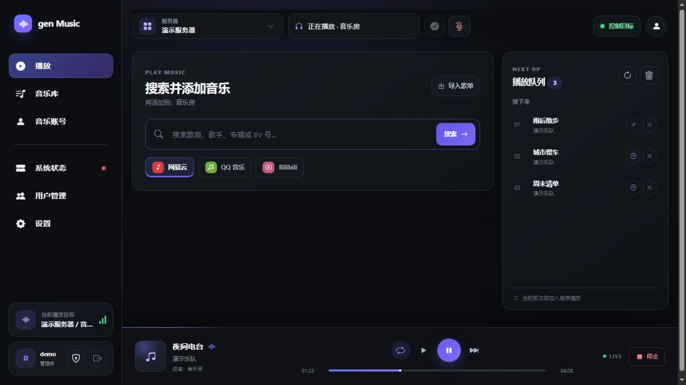
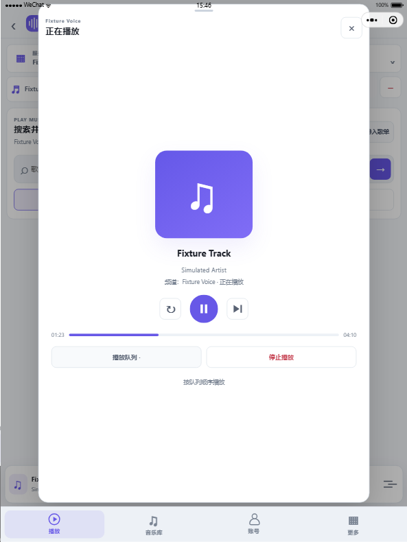
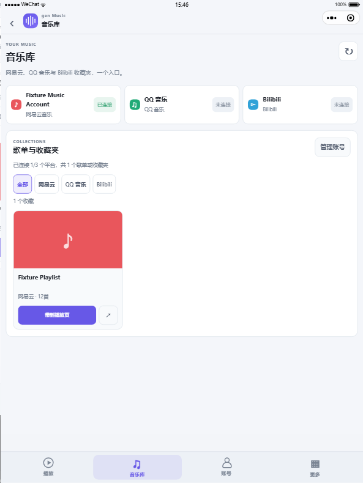
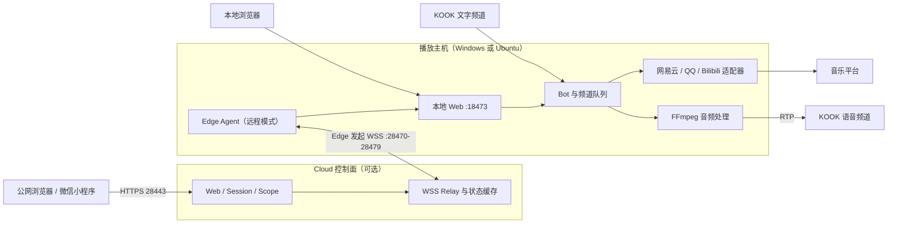
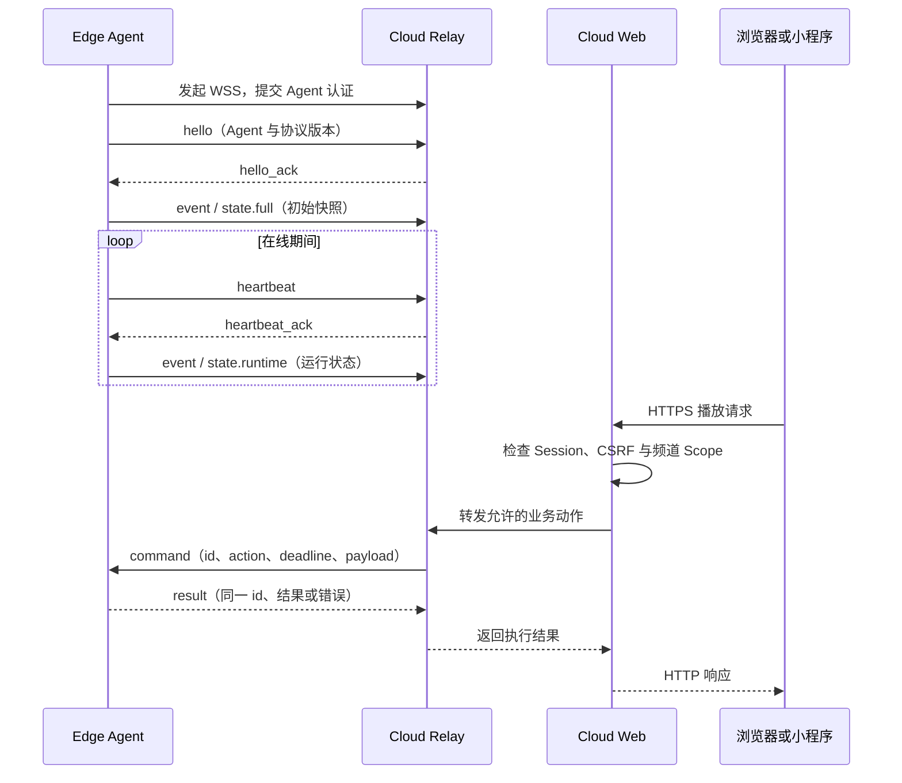
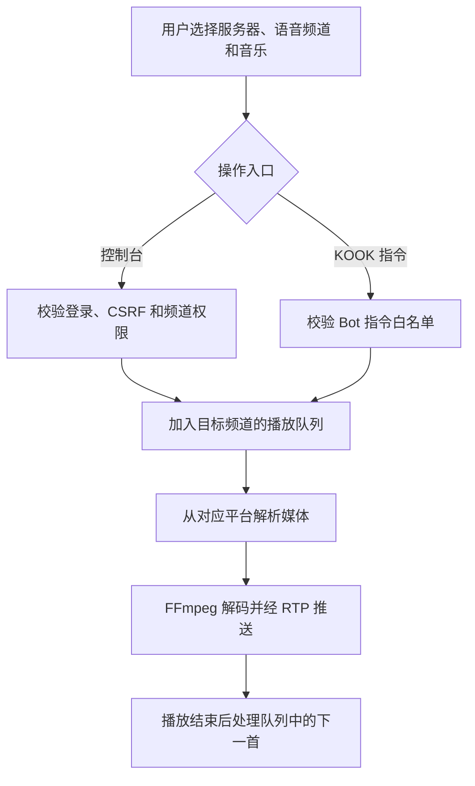
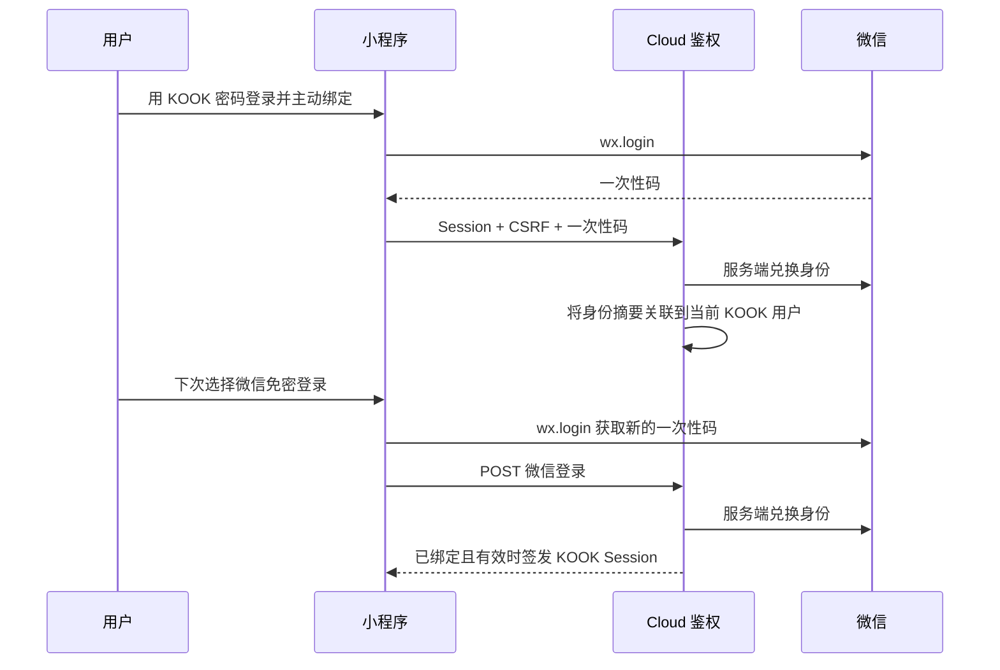

# KOOK Web Music

KOOK Web Music 是可自托管的音乐机器人和控制台。它能在 KOOK 语音频道播放网易云音乐、QQ 音乐和 Bilibili 音频。你可以从浏览器搜索、导入歌单和管理队列，也可以在 KOOK 频道使用机器人指令。仓库还提供可集成到微信小程序的原生控制页。

## 怎么跑起来

| 需求 | 启动入口 | 接下来读 |
| --- | --- | --- |
| 在 Windows 上运行机器人和本地控制台 | `python windows/run.py` | [Windows 快速启动](windows/README.md) |
| 在 Ubuntu 上运行机器人和本地控制台 | `python3 Ubuntu/run.py` | [Ubuntu 快速启动](Ubuntu/README.md) |
| 公网控制，家里或局域网的机器负责播放 | 云服务器运行 `cloud/run.py`，播放机运行 `edge/run.py` | [Cloud / Edge 部署](docs/cloud-edge-deployment.md) |
| 从微信小程序控制机器人 | 把 `wechat-miniapp/` 装配到宿主小程序，连接 Cloud HTTPS | [小程序集成](wechat-miniapp/README.md) |

### 第一次启动

下载仓库，或在 Git 终端运行 `git clone https://github.com/xrggen/Kook_Web_Music.git` 并进入 `Kook_Web_Music`。

1. 在 KOOK 创建机器人并邀请到目标服务器，给它进入目标语音频道和播放所需的权限。
2. 按平台指南准备 Python 3.10+、系统 Node.js 20+、npm 和 FFmpeg。网易云和 QQ 各用一个全局安装的 Node API，Bilibili 由 Python 适配器访问。
3. 从对应平台的 `.env.example` 建立本地 `.env`，填入 `BOT_TOKEN` 及机器人指令允许的服务器、频道或用户 ID。按表格选择入口启动。
4. 在播放机访问 [本地控制台](http://127.0.0.1:18473/)。用首次启动生成的管理员凭据登录并改密。选择服务器和语音频道，搜索一首歌加入队列。
5. 远程模式还需在 Cloud 的 `/healthz` 确认 `edge_connected: true`。**同一播放机只启动一个运行入口。** Edge 也提供本地控制台和 Bot。

安装、初始化、长期运行及升级见 [部署说明](docs/deployment.md)。

## 界面预览

### Web 控制台

播放页可选择服务器和语音频道、搜索三平台内容、调整待播顺序。音乐库集中展示已连接平台的歌单和收藏夹。截图使用演示数据。

[查看 Web 音乐库截图](docs/screenshots/web-library.jpg)

### 微信小程序

微信开发者工具中的演示数据展示了展开播放器与音乐库。小程序的集成方式见 [微信小程序控制台](wechat-miniapp/README.md)。

  
  

## KOOK 指令示例

先加入目标语音频道，再在机器人允许接收指令的文字频道发送命令。

| 指令 | 用途 |
| --- | --- |
| `/ping` | 检查机器人是否响应，正常会回复 `pong!` |
| `/加入` | 让机器人加入你所在的语音频道 |
| `/wy 晴天` | 从网易云搜索并播放 |
| `/qq 稻香` | 从 QQ 音乐搜索并播放 |
| `/bili 钢琴练习曲` | 搜索并播放 Bilibili 音频 |
| `/播放列表 1` | 查看队列第一页 |
| `/暂停`、`/继续`、`/跳过` | 控制当前播放 |
| `/帮助` | 查看完整指令 |

## 系统架构

播放机维护每个语音频道的队列、播放进度和平台登录态。Cloud 管理远程登录与资源授权，把控制请求转给 Edge。Cloud 断线时，Edge 的本地控制台、机器人指令和当前播放可继续运行。协议和运行组件详见 [架构说明](docs/architecture.md)。

## Cloud / Edge 协议

Edge 在 WSS 端口池中保持一条活动连接。Cloud 的读缓存接收 Edge 发来的状态，写操作和搜索走实时请求。协议版本、动作白名单及每个动作的超时见 [relay_protocol.py](shared/relay_protocol.py)。

## 点歌与小程序登录流程

小程序支持 KOOK 控制台账号密码登录。首次改密后，用户可主动绑定当前微信。下次选择微信免密登录时，小程序取得一次性码，由 Cloud 兑换微信身份并查找已关联的账号。会话与权限规则同样由 Cloud 应用。接口及错误码见 [Web API](docs/web-api.md)。

## 找文件

[项目文件地图](docs/file-map.md)按任务定位入口、Web、Bot、播放核心、协议、小程序和测试。[文档索引](docs/README.md)汇总配置、运维和安全说明。项目采用 [MIT 许可证](LICENSE)。
