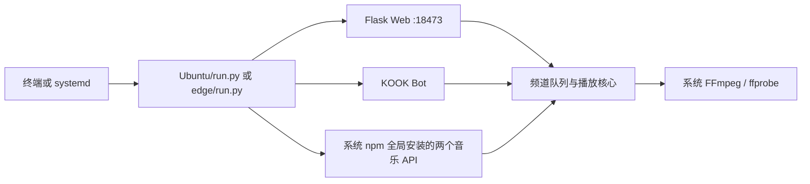

# Ubuntu 运行指南

这里是 KOOK Web Music 的 Ubuntu 运行目录，可运行机器人、本地控制台和播放核心。需要公网远程控制时，在这台播放主机运行 Edge，Cloud 可放到另一台服务器。

## 安装和启动

准备 Python 3.10+、系统 Node.js 20+ 和 npm。FFmpeg 从系统包安装。以下命令在仓库根目录执行，虚拟环境示例放在用户目录。

```bash
sudo apt update
sudo apt install -y python3 python3-venv ffmpeg
node --version
npm root --global
ffmpeg -version
ffprobe -version

python3 -m venv ~/.venvs/kook-web-music
source ~/.venvs/kook-web-music/bin/activate
python -m pip install -r Ubuntu/requirements.txt
npm install --global NeteaseCloudMusicApi@4.25.0 @sansenjian/qq-music-api@2.3.1
test -e Ubuntu/.env || (umask 077; cp Ubuntu/.env.example Ubuntu/.env)
```

全局 npm 安装需要该前缀的写权限。若由管理员安装，须确保实际运行账号的 `npm root --global` 指向同一安装位置。

在 `Ubuntu/.env` 填写 KOOK 的 `BOT_TOKEN` 及需要的 `ALLOWGROUP`、`ALLOWCHANNEL`、`ALLOWUSER`。如只从同一台机器访问，设置 `HOST=127.0.0.1`。

```bash
python Ubuntu/run.py
# 另开终端
curl -fsS http://127.0.0.1:18473/healthz
```

访问 [本地控制台](http://127.0.0.1:18473/)。首次登录使用 `INITIAL_ADMIN_USERNAME`（默认 `gen`）及初始化密码。未预设 `INITIAL_ADMIN_PASSWORD` 时，首次启动会在 `Ubuntu/data/bootstrap-admin.json` 生成临时凭据。登录后按提示改密。若从另一台机器管理，可使用 SSH 转发或按部署手册配置 HTTPS 反向代理。

接入远程控制时，先停止单机实例，按 [Cloud / Edge 部署](../docs/cloud-edge-deployment.md)配置 `edge/.env`，再从仓库根目录运行 `python edge/run.py`。需要开机自启时，使用 [systemd 示例](../docs/deployment.md#systemd)。

## 本机运行关系



systemd 使用的解释器和 PATH 决定 Python 依赖、Node 全局包和 FFmpeg 的查找结果。部署时用运行服务的账号检查实际依赖路径。[运维排障](../docs/operations.md) · [总体架构与协议图](../README.md#系统架构)
