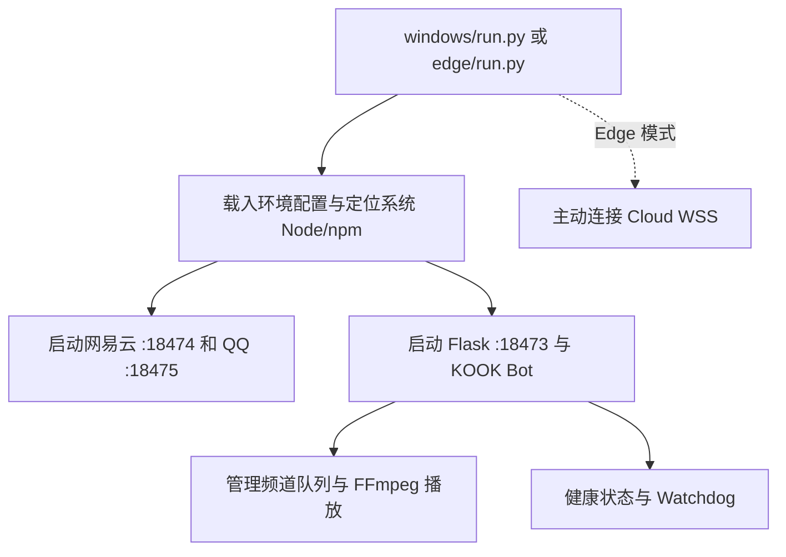

# Windows 运行指南

这里是 KOOK Web Music 的 Windows 运行目录。启动后，Bot、频道队列、音乐 API 和本地 Web 控制台在同一台机器上运行。需要公网控制时，使用仓库根目录的 Edge 入口。

## 安装和启动

准备 Python 3.10+、系统 Node.js 20+ 和 npm。安装 FFmpeg 后确认 `ffmpeg.exe` 和 `ffprobe.exe` 在 PATH，或在本地配置中填写 `FFMPEG_PATH` / `FFPROBE_PATH`。已有 `windows/ffmpeg/bin/` 的安装可继续使用。

从仓库根目录打开 PowerShell。先选中已有兼容 Python 环境，或建立并使用独立虚拟环境。以下命令使用当前环境的 Python。

```powershell
python --version
node --version
npm.cmd root --global
ffmpeg -version
ffprobe -version

python -m pip install -r windows/requirements.txt
npm.cmd install --global NeteaseCloudMusicApi@4.25.0 @sansenjian/qq-music-api@2.3.1
if (-not (Test-Path -LiteralPath windows/.env)) {
    Copy-Item -LiteralPath windows/.env.example -Destination windows/.env
}
```

在 `windows/.env` 填写 KOOK 的 `BOT_TOKEN`。按需填写 `ALLOWGROUP`、`ALLOWCHANNEL`、`ALLOWUSER`，各项使用逗号分隔的 ID。建议本机使用 `HOST=127.0.0.1`。

```powershell
python windows/run.py
```

打开 [本地控制台](http://127.0.0.1:18473/)。首次登录使用 `INITIAL_ADMIN_USERNAME`（默认 `gen`）及初始化密码。未预设 `INITIAL_ADMIN_PASSWORD` 时，首次启动会在 `windows/data/bootstrap-admin.json` 生成临时凭据。登录后按提示改密，再选择服务器与语音频道。

需要接入 Cloud 时，先结束单机实例，按 [Cloud / Edge 部署](../docs/cloud-edge-deployment.md)配置 `edge/.env`，再执行 `python edge/run.py`。在 CMD 也可以执行仓库根目录的 `start-edge.cmd`。

## 本机启动过程



用 `Invoke-RestMethod http://127.0.0.1:18473/healthz` 验证 Web 服务。API 提示不可用时，在启动机器人所用账号的终端运行 `npm.cmd root --global`，确认两个包都安装在该全局位置。[运维排障](../docs/operations.md) · [总体架构与协议图](../README.md#系统架构)
